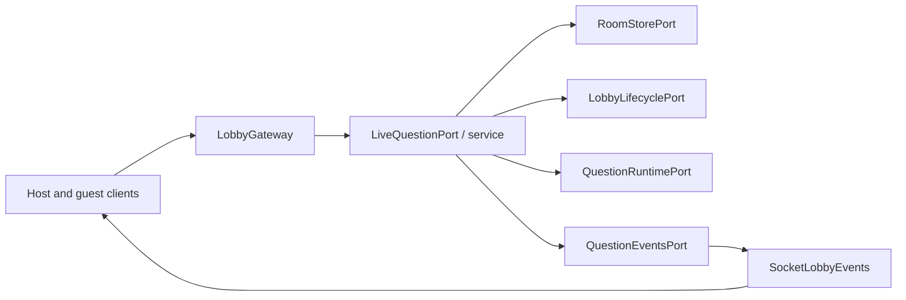
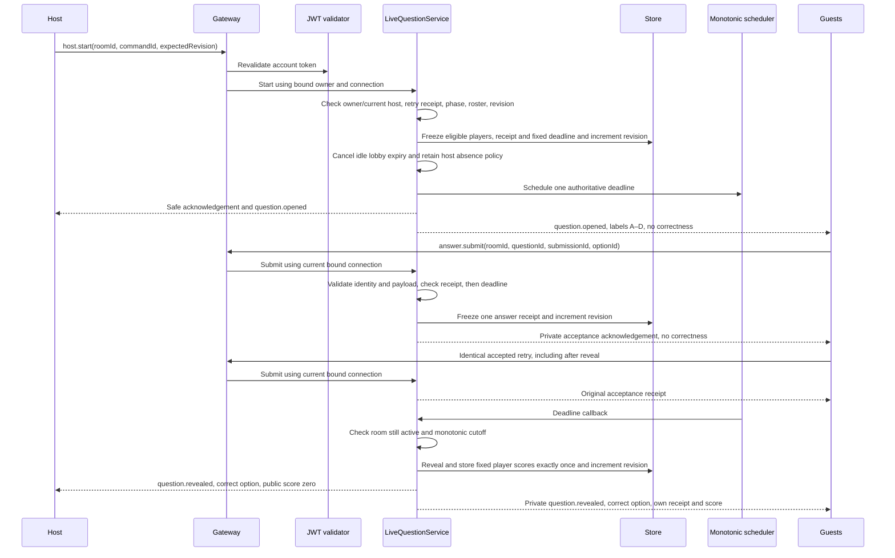
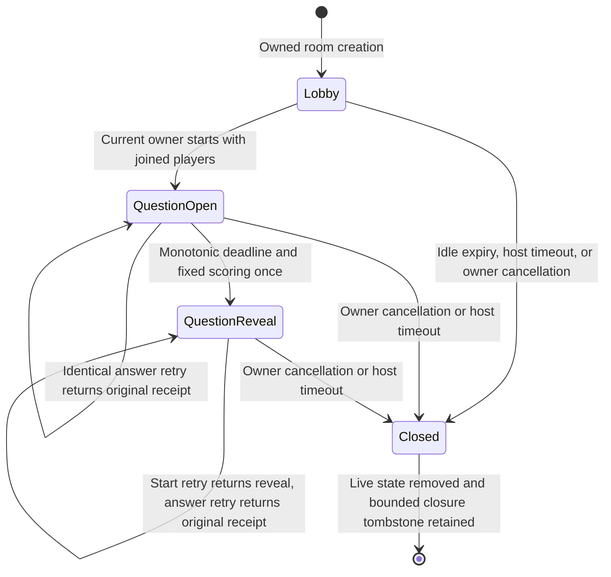
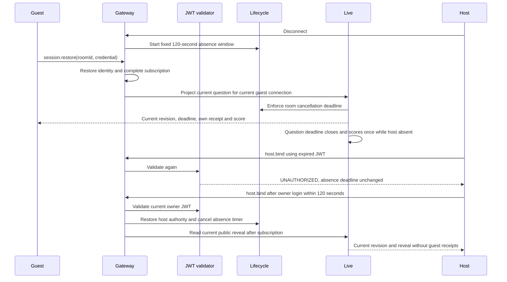
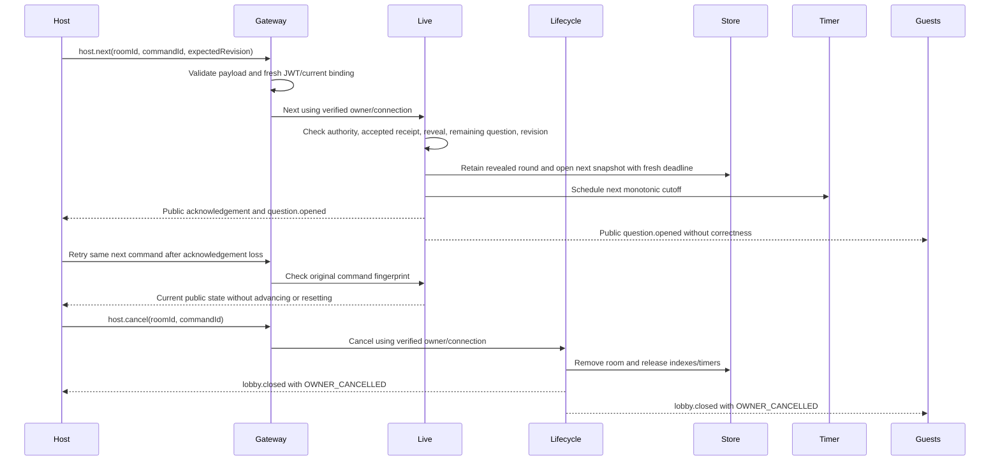
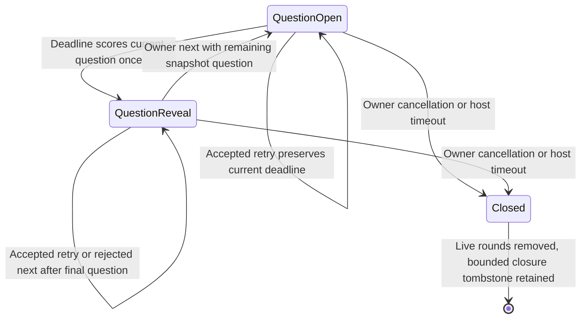

# Live-question and progression architecture

The [wire contract](../contracts/live-question.md) defines start, safe opening,
server timing, private answer receipts, retries, and scored reveal. This extends the
[lobby boundary](lobby-admission.md) after its completed OpenSpec archive.

`LobbyGateway` validates `host.start`, reuses the per-message JWT guard, checks
its actor binding, and invokes the `LIVE_QUESTION_PORT`. `LiveQuestionService`
checks current host authority through `LOBBY_LIFECYCLE_PORT`. All round mutations
are synchronous through `ROOM_STORE_PORT`; no awaited work can interleave a
phase/revision check and its commit. The existing in-memory store freezes each
replacement room; round eligibility and the accepted start receipt are frozen
inside it. Accepted answers and reveal scores are also frozen inside that round.
Start selects the first immutable snapshot question; next selects its immediate successor at reveal.

`answer.submit` accepts only room/question/submission/option UUIDs. The gateway
requires a bound guest, while the application derives player identity from the
current connection in the room aggregate. It validates question, option, and
eligibility, then checks the player's accepted receipt before deadline/phase.
An identical retry copies the original receipt; changed reused IDs and second
submissions conflict. The monotonic clock guards new answers independently of
timer delivery. Acceptance increments revision once, preserves the deadline,
and publishes no choice or correctness to other participants.

Reveal computes and stores each eligible player's 1000-or-zero points in the
same atomic phase/revision transition. Subsequent close callbacks see reveal and
cannot score again. The event port carries a public host state plus projections
for current guest connections. The socket adapter excludes those guests from
the public reveal and sends each subscribed guest only their own receipt/score.
Sync/restoration project the same private state after authority revalidation.
Roster publication explicitly selects display fields so restoration cannot
broadcast a private receipt.

`QUESTION_RUNTIME_PORT` isolates the monotonic decision clock, wall timestamps,
and cancellable scheduler. `SystemQuestionRuntime` uses Node's monotonic
performance clock and unreferenced timers. `QUESTION_EVENTS_PORT` isolates safe
opening/reveal publication; `SocketLobbyEvents` implements this and the existing
closure port. Symbol bindings live in `RoomModule`. Domain code imports no Nest,
Socket.IO, crypto, or timer implementations.

A state read can settle a delayed reveal callback before projecting its current
revision. Early timer callbacks rearm for the remaining monotonic interval;
repeated callbacks see reveal and cannot award points or publish twice. Wall-clock
jumps change public `serverNow` without changing elapsed decisions. Cancellation
and shutdown release timers. Stale callbacks carry the original room UUID and
cannot affect another room, even if its owner/PIN is reused.

Subscription completes before authority revalidation and question projection;
start/reveal during a delayed subscription is therefore reflected in the
acknowledgement. Roster events carry only display state. Complete question
snapshots use explicit public fields; correct options are projected only at
reveal. Answer acceptance never includes correctness. The [active recovery acceptance record](../contracts/active-game-recovery.md)
verifies this boundary through real clients. See [progression and cancellation](../contracts/game-progression.md) for the multi-question contract. Durable reporting remains a separate issue.

## Active recovery and host absence

Both host and guest question snapshots settle lifecycle deadlines, including
while already at reveal. A delayed host-timeout callback cannot let a public
host snapshot bypass cancellation. A closed snapshot fails with `ROOM_CLOSED`
and the retained reason instead of returning stale reveal or lobby data.
The gateway completes subscription, rechecks the actor, then synchronously
combines display roster and the current question projection. A read can settle
a delayed reveal before returning its newer revision and fixed scores.

Host absence changes connection authority rather than question phase. Open
still transitions to reveal at the original deadline, and reveal remains until
owner-controlled progression. Successful owner return before
the cutoff cancels absence without reopening or rescoring. Failed authentication
or foreign ownership cannot cancel or extend it. At the cutoff, cancellation
wins even if its callback is delayed; receipts and guest credentials lose their
authority with the room. A later disconnect begins a new absence window only for
the then-current bound host.

## Ordered progression and early ending

`host.next` uses the existing live-question port, current host authority, and
UUID/revision validation. Accepted command lookup precedes phase/revision checks
and distinguishes start from next. Prior revealed rounds remain frozen inside
the room, bounded by the snapshot's twenty-question limit. Each holds its
opening command fingerprint, eligible roster, accepted answers and fixed
scores. The current round begins with empty answers/scores and fresh wall and
monotonic deadlines. Guest totals sum revealed rounds; public opening scores
remain zero. Historical accepted-answer retries preserve their original receipt.
No new persistence, DI provider, or external service is needed.

Cancellation reuses `LobbyLifecyclePort` and `lobby.closed`; both later open and
reveal close with a reason and invalidate all command/answer authority. There is
no completed report or finished phase in #57. Finalization and report persistence
remain #58; owned history remains #59. The predecessor main `live-gameplay` spec
was synced and its fully verified change archived before this extension.
