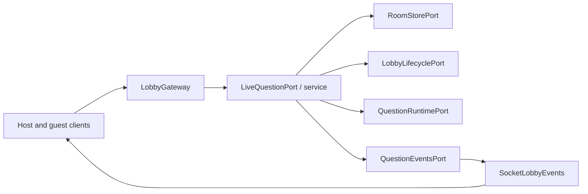
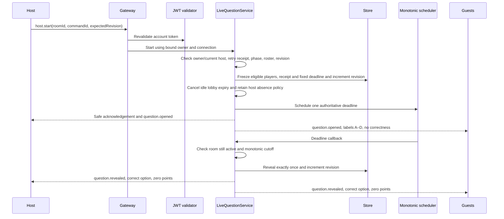
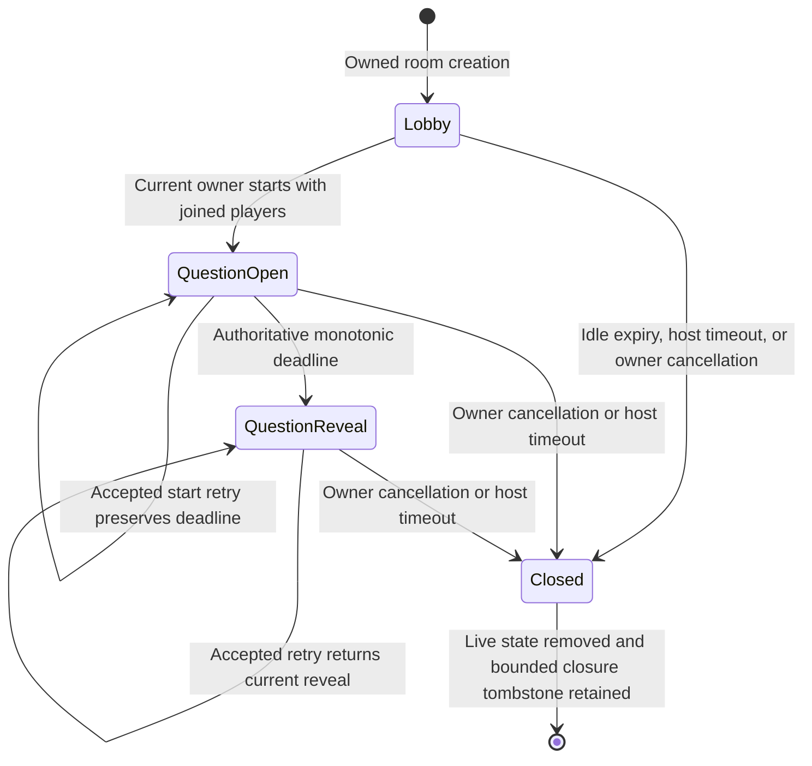

# Timed first-question architecture

The [wire contract](../contracts/live-question.md) defines start, safe opening,
server timing, retries, and no-answer reveal. This extends the
[lobby boundary](lobby-admission.md) after its completed OpenSpec archive.

`LobbyGateway` validates `host.start`, reuses the per-message JWT guard, checks
its actor binding, and invokes the `LIVE_QUESTION_PORT`. `LiveQuestionService`
checks current host authority through `LOBBY_LIFECYCLE_PORT`. All round mutations
are synchronous through `ROOM_STORE_PORT`; no awaited work can interleave a
phase/revision check and its commit. The existing in-memory store freezes each
replacement room; round eligibility and the accepted start receipt are frozen
inside it. Only the first immutable quiz snapshot question is selected.

`QUESTION_RUNTIME_PORT` isolates the monotonic decision clock, wall timestamps,
and cancellable scheduler. `SystemQuestionRuntime` uses Node's monotonic
performance clock and unreferenced timers. `QUESTION_EVENTS_PORT` isolates safe
opening/reveal publication; `SocketLobbyEvents` implements this and the existing
closure port. Symbol bindings live in `RoomModule`. Domain code imports no Nest,
Socket.IO, crypto, or timer implementations.

A state read can settle a delayed reveal callback before projecting its current
revision. Early timer callbacks rearm for the remaining monotonic interval;
repeated callbacks see reveal and cannot award points or publish twice. Wall-clock
jumps change public `serverNow` without changing elapsed decisions. Cancellation
and shutdown release timers. Stale callbacks carry the original room UUID and
cannot affect another room, even if its owner/PIN is reused.

Subscription completes before authority revalidation and question projection;
start/reveal during a delayed subscription is therefore reflected in the
acknowledgement. Roster events carry only display state. Complete question
snapshots use explicit public fields; correct options are projected only at
reveal. The no-answer slice supplies zero points. Answer receipts/scoring (#55),
full recovery acceptance (#56), progression, and durable reporting remain later
slices. The live-question OpenSpec change stays active.
