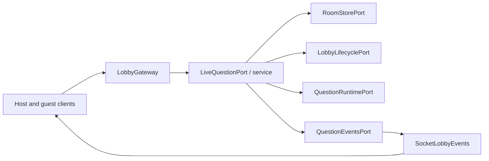
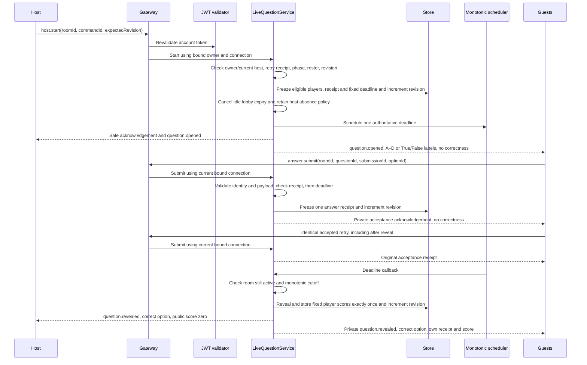
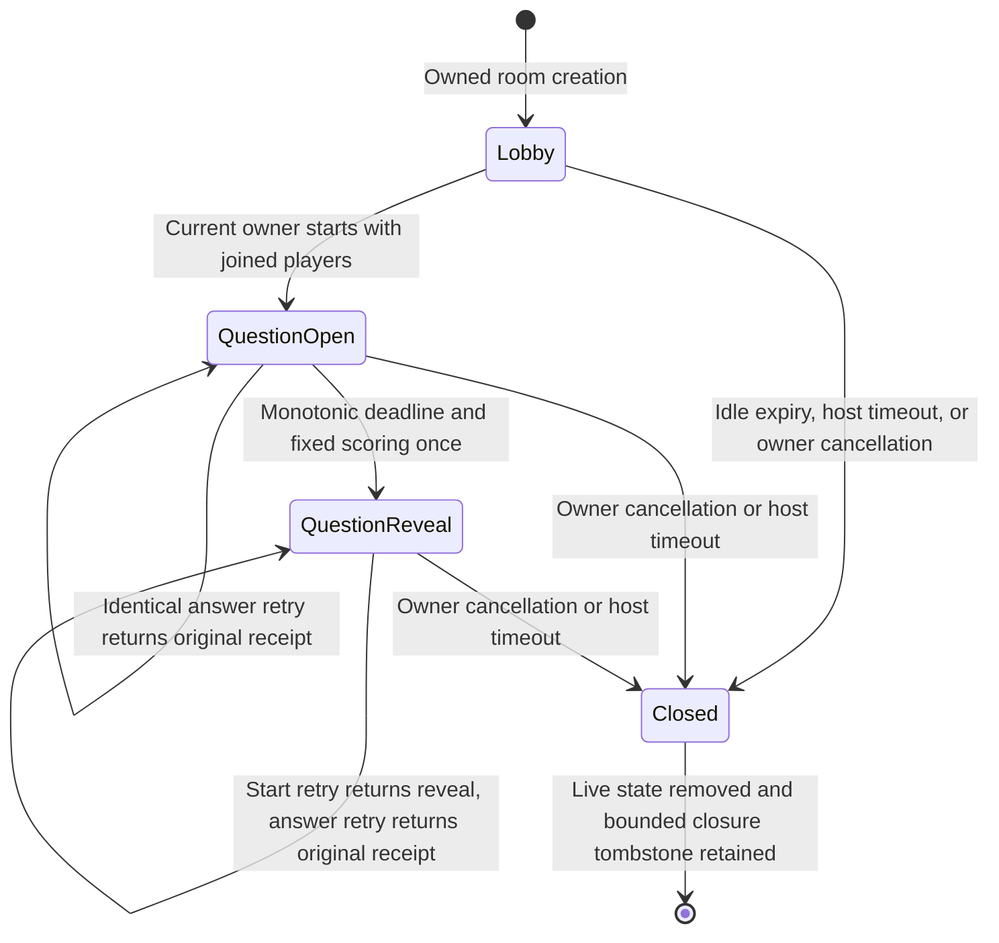
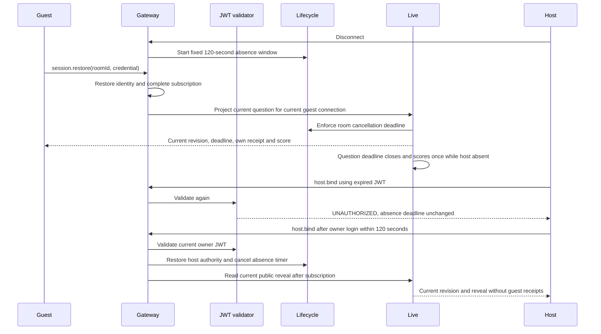
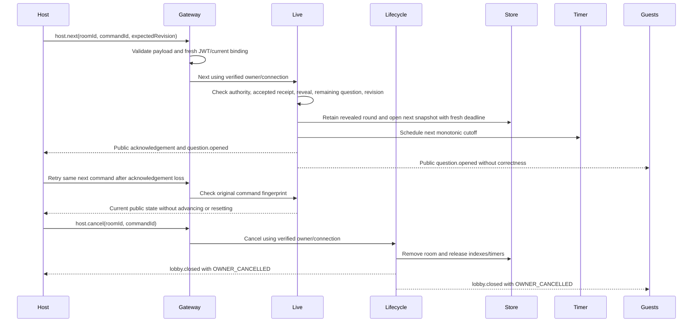
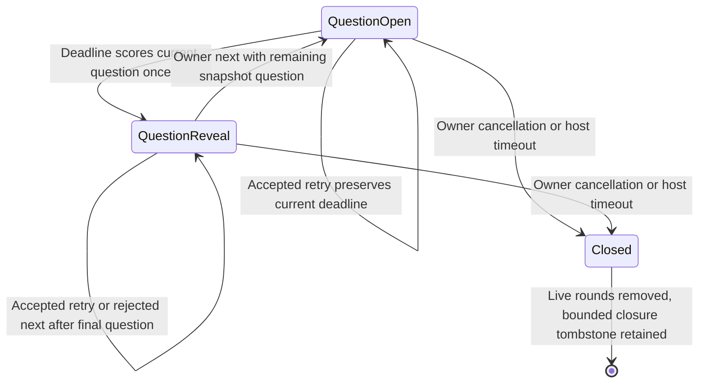
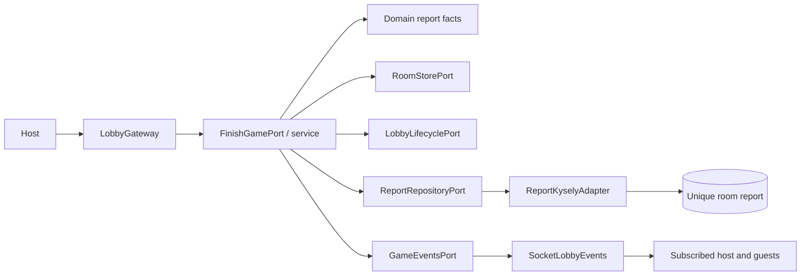
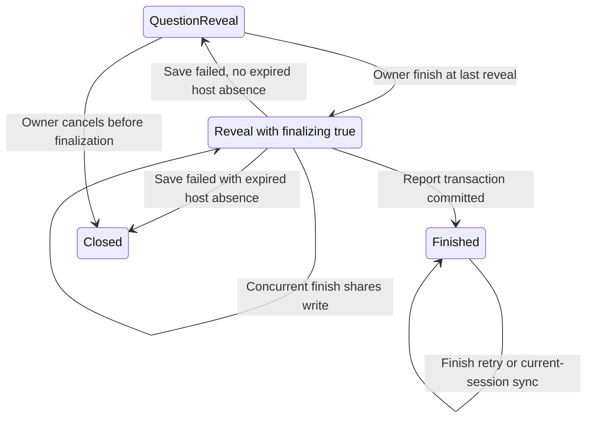
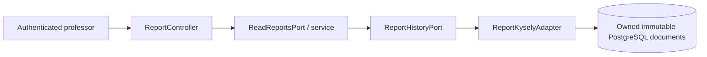
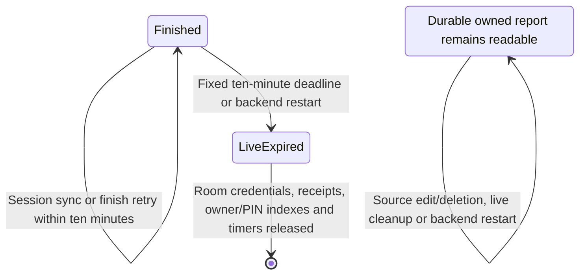

# Live-question and progression architecture

The [wire contract](../contracts/live-question.md) defines start, safe opening,
server timing, private answer receipts, retries, and scored reveal. This extends the
[lobby boundary](lobby-admission.md) after its completed OpenSpec archive.

`LobbyGateway` validates `host.start`, reuses the per-message JWT guard, checks
its actor binding, and invokes the `LIVE_QUESTION_PORT`. `LiveQuestionService`
checks current host authority through `LOBBY_LIFECYCLE_PORT`. All round mutations
are synchronous through `ROOM_STORE_PORT`; no awaited work can interleave a
phase/revision check and its commit. The existing in-memory store freezes each
replacement room; round eligibility and the accepted start receipt are frozen
inside it. Accepted answers and reveal scores are also frozen inside that round.
Start selects the first immutable snapshot question; next selects its immediate successor at reveal.

`answer.submit` accepts only room/question/submission/option UUIDs. The gateway
requires a bound guest, while the application derives player identity from the
current connection in the room aggregate. It validates question, option, and
eligibility, then checks the player's accepted receipt before deadline/phase.
An identical retry copies the original receipt; changed reused IDs and second
submissions conflict. The monotonic clock guards new answers independently of
timer delivery. Acceptance increments revision once, preserves the deadline,
and publishes no choice or correctness to other participants.

Reveal computes and stores each eligible player's 1000-or-zero points in the
same atomic phase/revision transition. Subsequent close callbacks see reveal and
cannot score again. The event port carries a public host state plus projections
for current guest connections. The socket adapter excludes those guests from
the public reveal and sends each subscribed guest only their own receipt/score.
Sync/restoration project the same private state after authority revalidation.
Roster publication explicitly selects display fields so restoration cannot
broadcast a private receipt.

`QUESTION_RUNTIME_PORT` isolates the monotonic decision clock, wall timestamps,
and cancellable scheduler. `SystemQuestionRuntime` uses Node's monotonic
performance clock and unreferenced timers. `QUESTION_EVENTS_PORT` isolates safe
opening/reveal publication; `SocketLobbyEvents` implements this and the existing
closure port. Symbol bindings live in `RoomModule`. Domain code imports no Nest,
Socket.IO, crypto, or timer implementations.







A state read can settle a delayed reveal callback before projecting its current
revision. Early timer callbacks rearm for the remaining monotonic interval;
repeated callbacks see reveal and cannot award points or publish twice. Wall-clock
jumps change public `serverNow` without changing elapsed decisions. Cancellation
and shutdown release timers. Stale callbacks carry the original room UUID and
cannot affect another room, even if its owner/PIN is reused.

Subscription completes before authority revalidation and question projection;
start/reveal during a delayed subscription is therefore reflected in the
acknowledgement. Roster events carry only display state. Complete question
snapshots use explicit public fields; correct options are projected only at
reveal. Answer acceptance never includes correctness. The [active recovery acceptance record](../contracts/active-game-recovery.md)
verifies this boundary through real clients. See [progression and cancellation](../contracts/game-progression.md) for the multi-question contract. See the [durable finalization contract](../contracts/game-finalization.md) for completion.

## Active recovery and host absence

Both host and guest question snapshots settle lifecycle deadlines, including
while already at reveal. A delayed host-timeout callback cannot let a public
host snapshot bypass cancellation. A closed snapshot fails with `ROOM_CLOSED`
and the retained reason instead of returning stale reveal or lobby data.
The gateway completes subscription, rechecks the actor, then synchronously
combines display roster and the current question projection. A read can settle
a delayed reveal before returning its newer revision and fixed scores.



Host absence changes connection authority rather than question phase. Open
still transitions to reveal at the original deadline, and reveal remains until
owner-controlled progression. Successful owner return before
the cutoff cancels absence without reopening or rescoring. Failed authentication
or foreign ownership cannot cancel or extend it. At the cutoff, cancellation
wins even if its callback is delayed; receipts and guest credentials lose their
authority with the room. A later disconnect begins a new absence window only for
the then-current bound host.

## Ordered progression and early ending

`host.next` uses the existing live-question port, current host authority, and
UUID/revision validation. Accepted command lookup precedes phase/revision checks
and distinguishes start from next. Prior revealed rounds remain frozen inside
the room, bounded by the snapshot's twenty-question limit. Each holds its
opening command fingerprint, eligible roster, accepted answers and fixed
scores. The current round begins with empty answers/scores and fresh wall and
monotonic deadlines. Guest totals sum revealed rounds; public opening scores
remain zero. Historical accepted-answer retries preserve their original receipt.
No new persistence, DI provider, or external service is needed.





Cancellation reuses `LobbyLifecyclePort` and `lobby.closed`; both later open and
reveal close with a reason and invalidate all command/answer authority. Cancelled games produce no completion. Issue #58 adds durable finalization
below; [owned history and finished-room cleanup](../contracts/report-history.md) complete #59. The predecessor main `live-gameplay` spec
was synced and its fully verified change archived before this extension.

## Durable finalization

`FINISH_GAME_PORT` routes the JWT-validated bound owner to `FinishGameService`.
The service validates the final reveal and revision, captures one deeply frozen
report candidate, and marks finalization synchronously before awaiting
`REPORT_REPOSITORY_PORT`. Concurrent valid commands share a pending promise.
The Kysely adapter uses a transaction, unique room primary key, conflict-ignore
insert, and owner-filtered read of the original document. No live credential or
answer receipt enters the durable payload. The domain report builder imports
only domain types and produces deterministic totals, shared ranks and counts.
`RoomModule` binds both ports and `GAME_EVENTS_PORT` to concrete adapters.

During persistence, `LobbyLifecycleService` suppresses host-absence settlement
and cancellation while synchronization still returns reveal plus `finalizing`.
Failure retains the candidate, clears the flag and reevaluates/rearms absence.
Success installs the stored report, advances revision once, disarms absence and
only then calls `GameEventsPort.finished`. The Socket.IO adapter broadcasts
`game.finished` to the subscribed room channel. Synchronization/restoration use
the same finished report; a lost event can be recovered without another write.
Terminal answers/progression/cancellation are rejected. No callback can close
an in-flight or finished room. Finished-room retention is handled separately below.



```mermaid
sequenceDiagram
  participant Host
  participant Gateway
  participant Finish as FinishGameService
  participant Lifecycle
  participant Reports as PostgreSQL report adapter
  participant Guests
  Host->>Gateway: host.finish(roomId, commandId, expectedRevision)
  Gateway->>Gateway: Revalidate JWT, payload and host binding
  Gateway->>Finish: Finalize as verified owner and connection
  Finish->>Lifecycle: Check authority and freeze finalization
  Finish->>Finish: Capture immutable candidate from last reveal
  Finish->>Reports: Transactional saveOnce by room UUID
  Note over Lifecycle: Keep reveal; suppress timeout cancellation
  alt Storage commits
    Reports-->>Finish: Original stored owned report
    Finish->>Finish: Commit finished and increment revision once
    Finish->>Lifecycle: Disarm cancellation timers
    Finish-->>Host: game.finished and successful acknowledgement
    Finish-->>Guests: game.finished
  else Storage fails or response is lost
    Reports-->>Finish: Persistence error
    Finish->>Lifecycle: Clear finalizing; settle or rearm absence
    Finish-->>Host: REPORT_SAVE_FAILED, retryable true
    Host->>Gateway: Retry original finish command
    Gateway->>Finish: Retry after fresh authorization
    Finish->>Reports: saveOnce with same frozen candidate
    Reports-->>Finish: Same original report if already stored
  end
```



## Owned history and finished-room retention

`ReportController` uses the global account JWT guard and `CurrentUser` identity,
then invokes `READ_REPORTS_PORT`. `ReadReportsService` depends only on
`REPORT_HISTORY_PORT`; its Kysely adapter filters both list and read by actual
owner ID. Foreign UUIDs and missing UUIDs map to the same HTTP 404, including
for admins. Reads use stored JSONB documents without consulting source quizzes
or live rooms. `RoomModule` shares one report adapter through Symbol bindings;
report DTOs document the versioned snapshot independently of editable quiz DTOs.



```mermaid
sequenceDiagram
  participant Owner
  participant HTTP as ReportController
  participant Read as ReadReportsService
  participant DB as ReportKyselyAdapter / PostgreSQL
  participant Timer as Lobby lifecycle scheduler
  participant Rooms as Process-local room store
  Owner->>HTTP: GET /reports with account JWT
  HTTP->>Read: List using verified owner ID
  Read->>DB: Owner-filtered documents, newest first
  DB-->>Owner: Stored reports
  Timer->>Rooms: Ten minutes after successful finish: remove live aggregate and indexes
  Note over Rooms: Credentials, receipts and timers expire; no cancellation
  Owner->>HTTP: GET /reports/:id after cleanup, source deletion or restart
  HTTP->>Read: Read using verified owner ID and validated UUID
  Read->>DB: Match owner ID and room/report UUID
  DB-->>Owner: Original report or indistinguishable 404 for missing/foreign
```



`completeFinalization` cancels play/absence timers and schedules one fixed
retention deadline. `settle` handles finished retention before cancellation logic;
checked reads enforce it even if timer delivery is delayed. Host rebind cannot
extend it. UUID/entry checks isolate stale callbacks from replacement rooms.
Cleanup removes the live aggregate and active lifecycle entry without publishing
`lobby.closed`, creating a closure tombstone or touching the durable repository.

## Mixed question formats

[True/False](../contracts/true-false.md) changes only the safe option-label
projection in the live service: truth labels are their fixed text, while
multiple-choice labels remain positional A–D. The same engine, command ports,
monotonic scheduler, receipts and state/sequence transitions above handle both
formats. There is no extra timing or scoring branch. Fixed truth IDs repeat
across questions; the existing question ID check scopes accepted submissions.

QuizSnapshot version 2 identifies mixed/truth content; the domain report builder
copies the snapshot's version. Freeze/copy behavior preserves type and choices
after source edits. Both report versions use the same immutable JSONB adapter
and owner-filtered history ports. There is no new migration or runtime provider.
