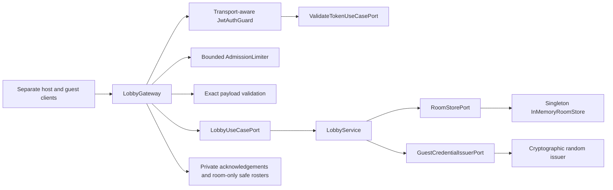
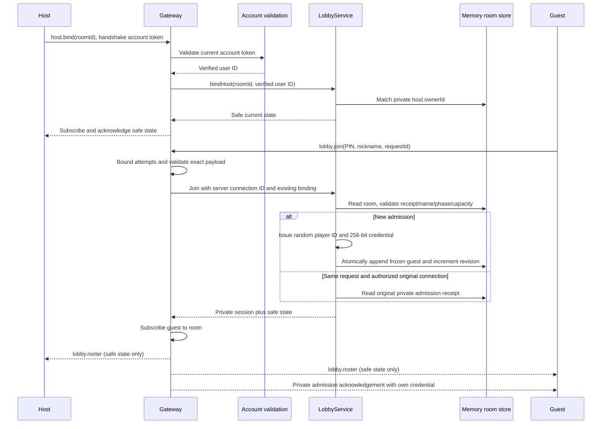
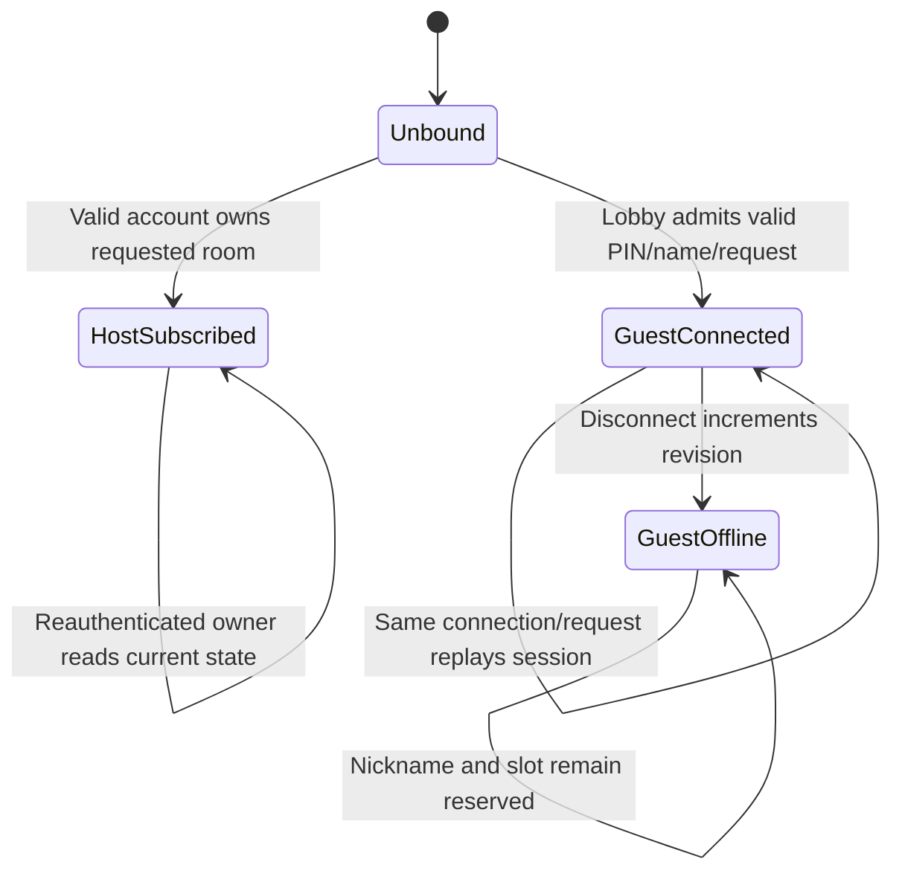

# Lobby admission architecture

Implemented for [#51](https://github.com/CusmaLinux/robinhoot/issues/51).
See the [Socket.IO contract](../contracts/lobby-admission.md) and
[room creation architecture](room-creation.md).

RoomModule binds all application ports with Symbols. The gateway knows
Socket.IO rooms and connection handles; application inputs contain only plain
IDs/data. The domain has no framework imports. AuthModule exports the existing
validation port for the gateway guard. Private socket handlers explicitly use
the same guard as HTTP, with handshake account-token extraction and identity
attachment for WebSockets. Only `lobby.join` is marked public. HTTP extraction
and default protection remain unchanged; unsupported private transport contexts
fail closed. A gateway exception filter maps typed admission/auth errors to
private failure acknowledgements and hides unexpected details.

The store publishes immutable room aggregates to all room/owner/PIN indexes in
a synchronous `mutate` operation. Join validation, receipt lookup, uniqueness,
capacity checking, credential issuance, and mutation contain no awaits, so
single-process concurrent messages cannot interleave these steps. The snapshot
is retained intact. Public state is built from an explicit field projection,
never from aggregate spreading. Network subscription/broadcast belongs to the
gateway; credential-bound atomic restore/subscription remains #52.

Failed messages never mutate membership/revision or subscribe a caller. One
connection binds to one room/actor. Guest receipts retain at most thirty secrets
per room and are bound to their admitting connection; disconnect removes the
plaintext receipt secret but keeps the room/player verifier. Socket IDs route
live responses and bind retries; they are not client-supplied authentication.
Disconnects update only their currently bound guest and publish offline state.
The source limiter survives connection churn and bounds its table at 10,000
entries; connection budgets are released on disconnect. Source headers are not
trusted. No timer or database account is created for a guest.

Reconnect, replacement-session authority, lifecycle cleanup, owner cancellation,
and automatic closure remain #52–#53. Process restart loses live state. This
implementation does not claim full lobby-change completion or archival.
