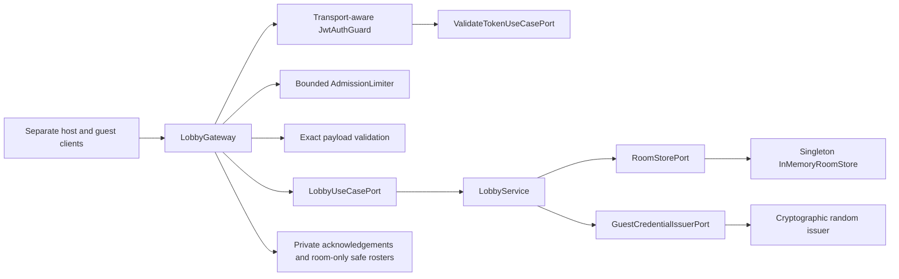
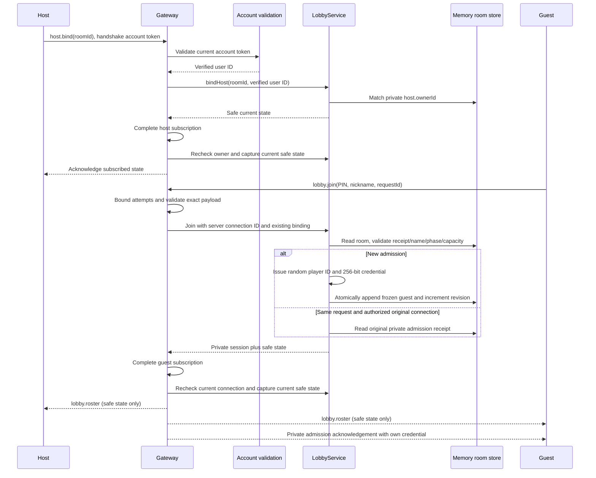
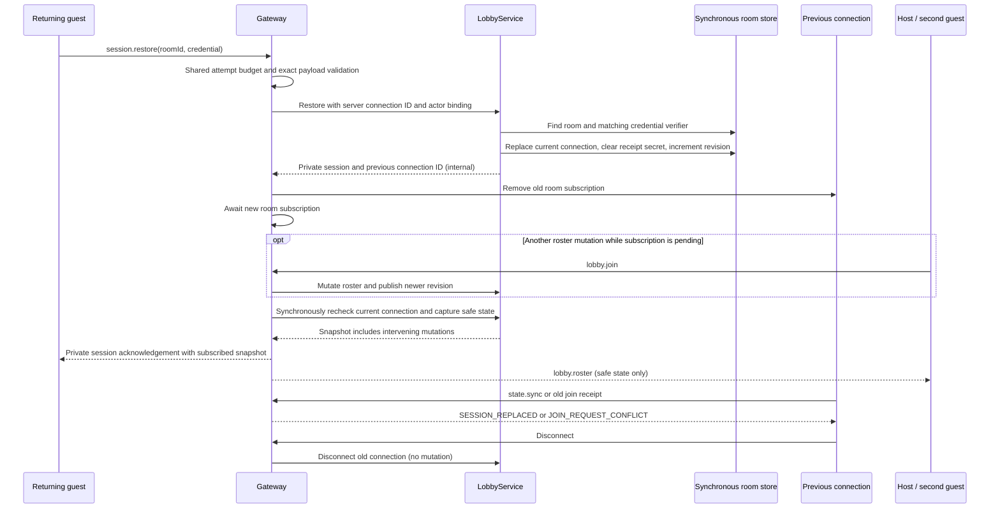

# Lobby admission architecture

Implemented for [#51](https://github.com/CusmaLinux/robinhoot/issues/51) and
[#52](https://github.com/CusmaLinux/robinhoot/issues/52).
See the [Socket.IO contract](../contracts/lobby-admission.md) and
[room creation architecture](room-creation.md).

RoomModule binds all application ports with Symbols. The gateway knows
Socket.IO rooms and connection handles; application inputs contain only plain
IDs/data. The domain has no framework imports. AuthModule exports the existing
validation port for the gateway guard. Private socket handlers explicitly use
the same guard as HTTP, with handshake account-token extraction and identity
attachment for WebSockets. `lobby.join`, `session.restore`, and `state.sync` bypass account authentication
at the guard; restore verifies the guest secret, sync verifies the bound current
guest connection or explicitly revalidates the host account token through the
existing Symbol-bound validation port. HTTP extraction
and default protection remain unchanged; unsupported private transport contexts
fail closed. A gateway exception filter maps typed admission/auth errors to
private failure acknowledgements and hides unexpected details.

The store publishes immutable room aggregates to all room/owner/PIN indexes in
a synchronous `mutate` operation. Join validation, receipt lookup, uniqueness,
capacity checking, credential issuance, and mutation contain no awaits, so
single-process concurrent messages cannot interleave these steps. The snapshot
is retained intact. Public state is built from an explicit field projection,
never from aggregate spreading. Network subscription/broadcast belongs to the
gateway. The adapter subscription completes before a synchronous authority
recheck and current snapshot capture; this includes mutations during subscription
and covers subsequent mutations through events. Join/restore/host binding/sync
share this subscription path. A pending operation superseded by a replacement
fails and leaves the channel. See the [restore contract](../contracts/lobby-restoration.md).

```mermaid
stateDiagram-v2
  [*] --> Unbound
  Unbound --> HostSubscribed: Valid account owns requested room
  Unbound --> GuestConnected: Lobby admits valid PIN/name/request
  GuestConnected --> GuestConnected: Same connection/request replays session
  GuestConnected --> GuestOffline: Disconnect increments revision
  GuestOffline --> GuestOffline: Nickname and slot remain reserved
  GuestOffline --> GuestConnected: Valid room credential restores same identity
  GuestConnected --> GuestConnected: Credential rebind increments revision
  GuestConnected --> Replaced: Another connection restores this identity
  Replaced --> Replaced: Sync and join receipts rejected; disconnect has no authority
  HostSubscribed --> HostSubscribed: Reauthenticated owner reads current state
```

Failed messages never mutate membership/revision or subscribe a caller. One
connection binds to one room/actor. Guest receipts retain at most thirty secrets
per room and are bound to their admitting connection; disconnect removes the
plaintext receipt secret but keeps the room/player verifier. Replacement clears
the receipt secret and requires the receipt connection to remain the current
guest connection before replay. Each restore verifies the supplied secret against
only the requested room's guests using SHA-256 and timing-safe digest comparison.
It atomically replaces the stored connection and increments revision, then evicts
the old socket from the room. The old WeakMap actor binding remains until
disconnect to prevent a stale connection from joining as a different actor. Socket IDs route
live responses and bind retries; they are not client-supplied authentication.
Disconnects update only their currently bound guest and publish offline state.
The source limiter survives connection churn and bounds its table at 10,000
entries; connection budgets are released on disconnect. Source headers are not
trusted. No timer or database account is created for a guest.

Lifecycle cleanup, owner cancellation, host absence, and automatic closure
remain #53. Process restart loses live state. This
implementation does not claim full lobby-change completion or archival.

## Credential restoration sequence

No transport object or cryptographic library is added to the application/domain.
Credential verification belongs to the existing issuer port and crypto adapter.
The room registry still uses its existing synchronous, immutable mutation path;
no database migration, async persistence, queue, or distributed room guarantee
is introduced. Concurrent credential holders resolve to the most recent successful
binding; an operation must recheck that binding after awaiting subscription.
