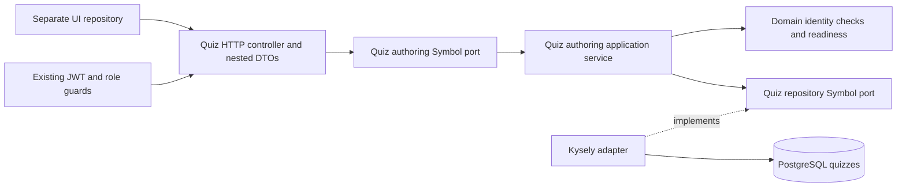
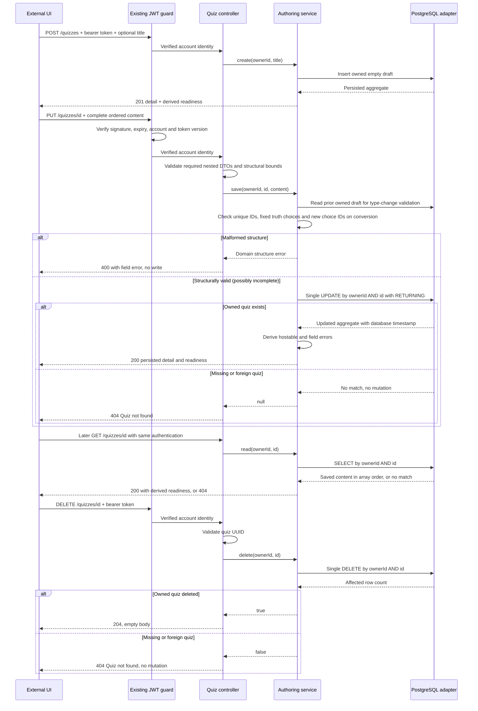
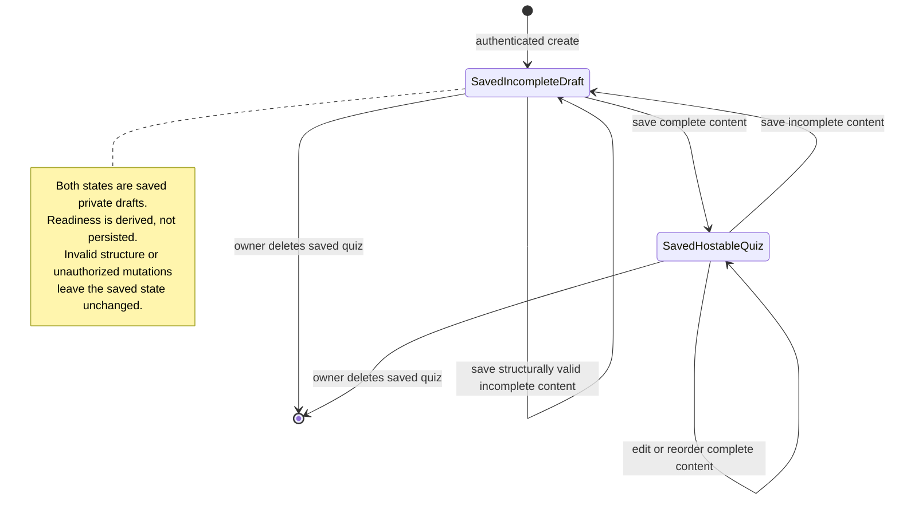

# Private draft authoring architecture

Implemented scope: [#47](https://github.com/CusmaLinux/robinhoot/issues/47), [#48](https://github.com/CusmaLinux/robinhoot/issues/48), and [#49](https://github.com/CusmaLinux/robinhoot/issues/49). See the [public contract](../contracts/quiz-drafts.md) and [acceptance walkthrough](../contracts/quiz-authoring-walkthrough.md).

The composition root binds both Symbol ports in `QuizModule`, imported by `AppModule`. Domain types, identity checks, and readiness have no NestJS or Kysely imports. The application receives verified owner IDs and content through its inbound port, validates identity consistency, and calls its outbound repository port. Request objects and database rows stay in adapters. The outbound adapter maps rows explicitly to exclude owner IDs. Every read/list/update/delete query includes the verified owner predicate; admins have no ownership bypass.

DTOs check shape, scalar types, bounded collections/text, and object elements before use-case dispatch. Duplicate UUIDs and dangling correct-option references produce a domain structure error translated to HTTP 400 by the controller. Incomplete text, multiple-choice option counts, selections, and durations pass save validation and return readiness errors. True/False requires its exact fixed choice mapping on save. No write occurs on structural errors.

The aggregate is one row: generated quiz UUID, owner UUID referencing `users`, title, ordered JSONB questions, and UTC creation/update timestamps. Stable client UUIDs identify questions and options inside the aggregate; correct-option UUIDs reference options inside their question. Saving replaces the content atomically and preserves creation time, with `clock_timestamp()` supplying update time. Arrays explicitly store order. Concurrent saves have last-write-wins semantics. This slice adds no schema migration or in-memory cache.

Integration tests exercise save/retrieve, two-question and option reordering, readiness, ownership denial for both user/admin, and unchanged content/timestamps on rejection. An independent application/database pool reopens a committed edited aggregate. No production database is used.

Deletion follows the same inbound Symbol port → application service → outbound Symbol port → Kysely adapter path. Its boolean result maps affected rows to HTTP 204/404 at the controller. A single owner-scoped DELETE removes only the source aggregate; no preflight read, game/report imports, additional module bindings, or cascading foreign keys are introduced. The dedicated database suite verifies committed deletion through an independent app/pool, owner-list removal, retained other drafts, user/admin denial, and invalid credentials/UUIDs.

Live rooms and reports are future independent snapshot owners. Their designs require copying quiz content at room creation and persisting report snapshots without a cascading source-quiz foreign key. Source deletion must never invoke their lifecycle or delete their snapshots. Concrete live/report retention regressions belong to those implementations; this stage reviews the current schema and dependency direction rather than fabricating future storage.

Kysely's `FileMigrationProvider` loads migration files by directory at runtime. `.fallowrc.json` declares that directory as an entry point so static analysis recognizes these database lifecycle exports without artificial imports. The CI audit installs dependencies before analysis.

## True/False extension

[Issue #60's format contract](../contracts/true-false.md) adds fixed True/False
UUIDs through the same ports and adapters. The authoring service reads the
prior owned draft before structural validation to reject reused choice IDs
when an existing question changes type. Invalid conversions leave the stored
state unchanged in the state diagram above; valid complete or incomplete
conversions use the same two saved states. No new provider or table is needed.

Domain readiness checks truth mappings as well as completeness. The immutable
room snapshot reader emits version 2 when any question is True/False; reports
retain that version and the original content. Legacy multiple-choice storage
and version-1 reports remain readable and playable without backfill.

## Optional image metadata

[Question images](../contracts/question-images.md) add bounded `imageUrl` and
`imageDescription` strings to the existing JSONB question document. The inbound
DTO calls the framework-free URL predicate; domain structure/readiness checks
also prevent malformed persisted references from becoming hostable. The same
ports and owner-scoped adapter save/read the strings verbatim. The save sequence
validates media before its UPDATE, so invalid metadata keeps the prior saved
state in the state diagram above. Omitting metadata on full replacement removes
it only from the editable source. There are no new providers, tables or migrations.
