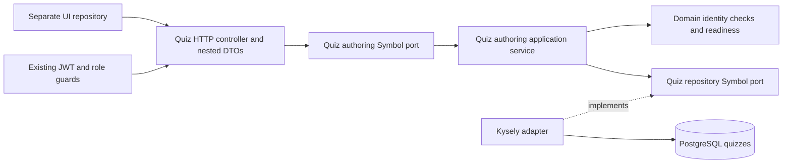
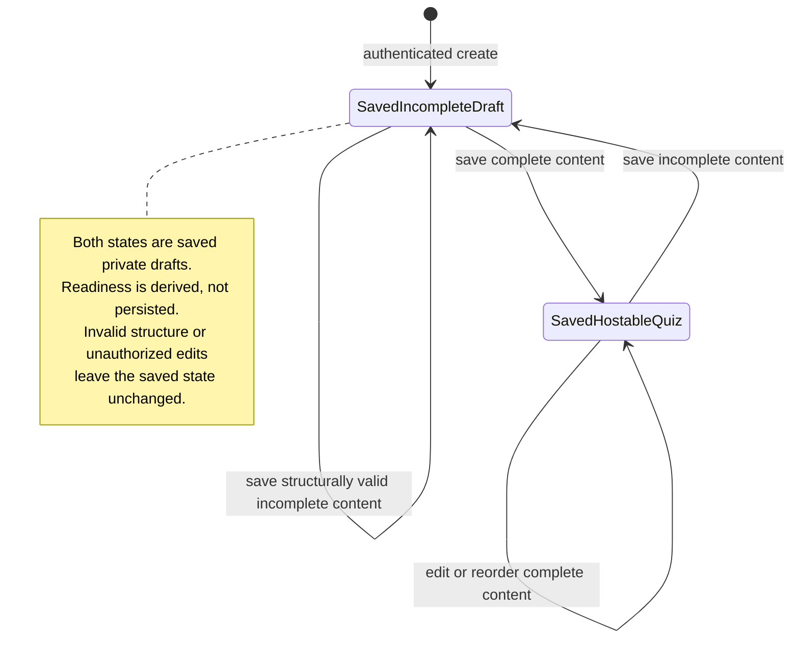

# Private draft authoring architecture

Implemented scope: [#47](https://github.com/CusmaLinux/robinhoot/issues/47) and [#48](https://github.com/CusmaLinux/robinhoot/issues/48). See the [public contract](../contracts/quiz-drafts.md). Deletion and final authoring acceptance remain in #49.



The composition root binds both Symbol ports in `QuizModule`, imported by `AppModule`. Domain types, identity checks, and readiness have no NestJS or Kysely imports. The application receives verified owner IDs and content through its inbound port, validates identity consistency, and calls its outbound repository port. Request objects and database rows stay in adapters. The outbound adapter maps rows explicitly to exclude owner IDs. Every read/list/update query includes the verified owner predicate; admins have no ownership bypass.

DTOs check shape, scalar types, bounded collections/text, and object elements before use-case dispatch. Duplicate UUIDs and dangling correct-option references produce a domain structure error translated to HTTP 400 by the controller. Incomplete text, option counts, selections, and durations pass save validation and return readiness errors. No write occurs on structural errors.

```mermaid
sequenceDiagram
    participant UI as External UI
    participant Auth as Existing JWT guard
    participant HTTP as Quiz controller
    participant App as Authoring service
    participant DB as PostgreSQL adapter
    UI->>Auth: POST /quizzes + bearer token + optional title
    Auth->>HTTP: Verified account identity
    HTTP->>App: create(ownerId, title)
    App->>DB: Insert owned empty draft
    DB-->>App: Persisted aggregate
    App-->>UI: 201 detail + derived readiness
    UI->>Auth: PUT /quizzes/id + complete ordered content
    Auth->>Auth: Verify signature, expiry, account and token version
    Auth->>HTTP: Verified account identity
    HTTP->>HTTP: Validate required nested DTOs and structural bounds
    HTTP->>App: save(ownerId, id, content)
    App->>App: Check unique IDs and correct-option references
    alt Malformed structure
      App-->>HTTP: Domain structure error
      HTTP-->>UI: 400 with field error; no write
    else Structurally valid (possibly incomplete)
      App->>DB: Single UPDATE by ownerId AND id with RETURNING
      alt Owned quiz exists
        DB-->>App: Updated aggregate with database timestamp
        App->>App: Derive hostable and field errors
        App-->>UI: 200 persisted detail and readiness
      else Missing or foreign quiz
        DB-->>App: No match, no mutation
        App-->>HTTP: null
        HTTP-->>UI: 404 Quiz not found
      end
    end
    UI->>HTTP: Later GET /quizzes/id with same authentication
    HTTP->>App: read(ownerId, id)
    App->>DB: SELECT by ownerId AND id
    DB-->>App: Saved content in array order, or no match
    App-->>UI: 200 with derived readiness, or 404
```



The aggregate is one row: generated quiz UUID, owner UUID referencing `users`, title, ordered JSONB questions, and UTC creation/update timestamps. Stable client UUIDs identify questions and options inside the aggregate; correct-option UUIDs reference options inside their question. Saving replaces the content atomically and preserves creation time, with `clock_timestamp()` supplying update time. Arrays explicitly store order. Concurrent saves have last-write-wins semantics. This slice adds no schema migration or in-memory cache.

Integration tests exercise save/retrieve, two-question and option reordering, readiness, ownership denial for both user/admin, and unchanged content/timestamps on rejection. An independent application/database pool reopens a committed edited aggregate. No production database is used.

Kysely's `FileMigrationProvider` loads migration files by directory at runtime. `.fallowrc.json` declares that directory as an entry point so static analysis recognizes these database lifecycle exports without artificial imports. The CI audit installs dependencies before analysis.
