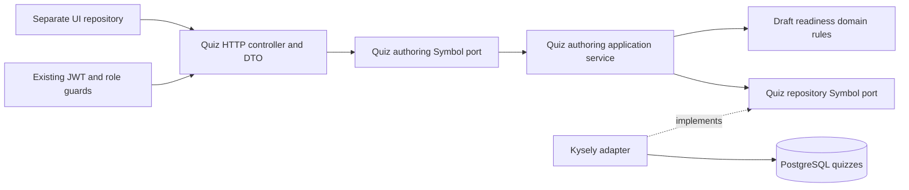
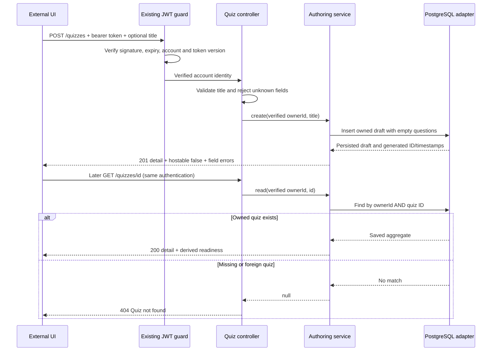
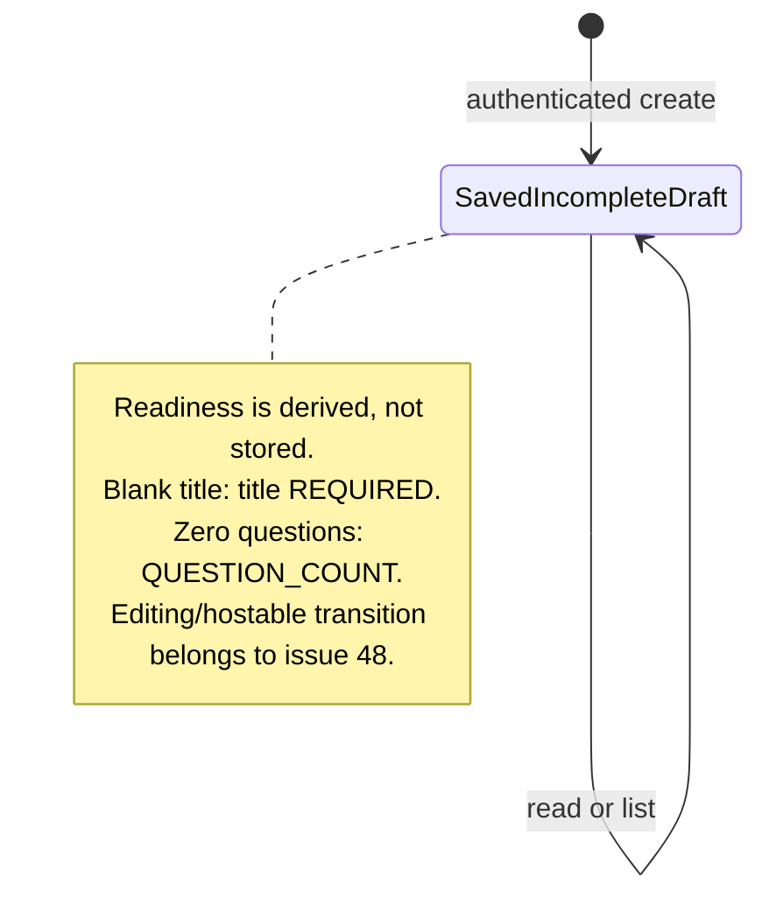

# Private draft create/list/read architecture

Implemented scope: [issue #47](https://github.com/CusmaLinux/robinhoot/issues/47). See the [public contract](../contracts/quiz-drafts.md). Editing and deletion are later slices.

The composition root binds both Symbol ports in `QuizModule`, imported by `AppModule`. Domain types/readiness have no NestJS or Kysely imports. The application sees verified owner IDs and repository contracts; request objects and database rows stay in adapters. The outbound adapter maps rows explicitly, so owner IDs cannot leak into response objects. Every read/list query includes the verified owner predicate. There is no role-based ownership bypass.

The aggregate is a single row: generated UUID, owner UUID referencing `users`, a title capped at 200 characters, empty JSONB questions, and creation/update timestamps. No in-memory draft cache exists. A dedicated database integration test proves that an independently constructed app with its own database connection can reopen committed content.

Kysely's `FileMigrationProvider` loads migration files by directory at runtime. `.fallowrc.json` declares that directory as an entry point so static analysis recognizes these database lifecycle exports without adding artificial imports or hiding dead-code rules. The CI audit installs project dependencies before analysis to avoid degraded dependency resolution.
