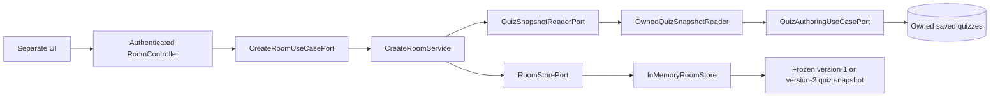
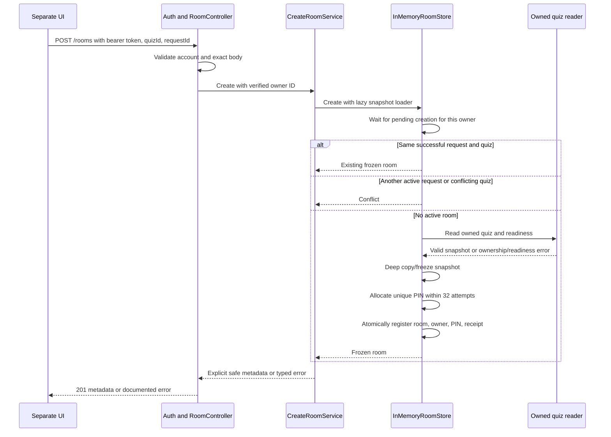
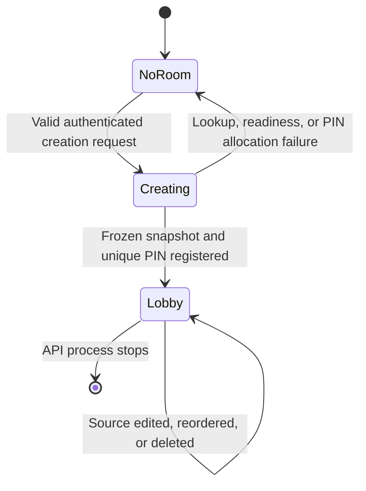

# Owned room creation architecture

Implemented for [issue #50](https://github.com/CusmaLinux/robinhoot/issues/50).
See the [HTTP contract](../contracts/room-creation.md). [Guest admission](lobby-admission.md) is implemented in #51; reconnect and
lifecycle work remain in the active `add-game-lobby` change.

## Components and dependencies

RoomModule binds application ports through Symbols and imports only QuizModule's
exported authoring port. The cross-feature reader is an outbound adapter; the
room use case does not depend on quiz infrastructure, HTTP, or PostgreSQL.
Domain room types and errors have no framework imports. The existing application
layer convention permits Nest injection decorators in services. Creation preserves quiz mutation rules and requires no database schema changes.
The admission slice adds explicit WebSocket handling to the account guard.

The singleton memory adapter owns room/owner/PIN indexes and per-owner pending
creation promises. Its `create` operation accepts a lazy snapshot loader so the
adapter can reserve an owner across asynchronous I/O, replay a successful
receipt without I/O, and release reservations in a `finally` block after failure.
It stores one receipt on the room, so retries do not grow a receipt collection.
`findById` and `findByPin` are internal ports, with no public HTTP read endpoint.
Returned internal aggregates and nested snapshots are frozen and copied at the
storage boundary. Only an explicit metadata projection crosses HTTP.

## Creation and retry sequence

PIN collision checks and registry publication have no await between them, so
two owners cannot interleave those operations in one process. Per-owner locking
prevents two awaited reads from creating two rooms. Errors commit no indexes;
source edits/deletion never reach the independent snapshot. Host authority
comes only from matching a reauthenticated account to private `host.ownerId`.

## Implemented creation state

These diagrams describe creation transitions. Guest joining and explicit socket
host binding are documented in the [admission architecture](lobby-admission.md).
Reconnect, thirty-minute expiry, cancellation, and cleanup belong to #52–#53. RoomStore will need lifecycle operations in that work; the creation
slice does not claim lifecycle acceptance or full-change archival. This single
process storage is intentionally unsuitable for multiple live-room replicas.
