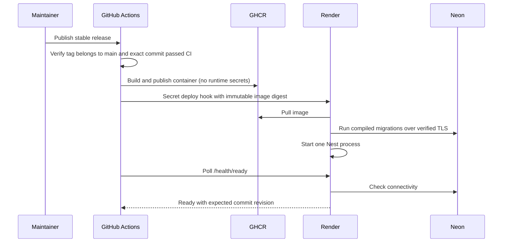

# Release deployment: Render Free and Neon Free

This is the selected MVP deployment target, replacing the Oracle proposal.
The API is one Nest process on Render. PostgreSQL is persisted in Neon and
accessed over the public internet with certificate-verified TLS. This deliberately
replaces #62's original private-network database assumption; it is not a private
network connection. No UI assets are hosted here.

## Why deploy releases instead of every merge?

CI checks PRs and pushes to `main`. Publishing a stable GitHub release named
`vMAJOR.MINOR.PATCH` selects the deployment boundary. A merge alone deploys nothing.

- Each replacement process loses active in-memory games, including during an
  otherwise healthy rolling deployment. Release outside classroom sessions.
- Releases group related changes behind a named version and explicit notes.
- A known image digest makes diagnosis and compatible rollback reproducible.
- The tradeoff is that fixes wait for a release. Publish a small patch release
  for an urgent fix; do not bypass CI.

Deploying each merge is reasonable later with a separate staging environment,
safe migrations and a strategy for draining/recovering active games. Release
deployment does not prevent Render itself from restarting or sleeping a service.

## What the automation does

CI also builds and starts the actual production image against a dedicated
PostgreSQL service, verifies readiness, and restarts it to check migration
idempotence. No CI test connects to the deployed Neon database.

Deployments are serialized and not cancelled in flight. GitHub concurrency can
replace an older pending run with a newer one; it is not a FIFO release queue.
The deploy job uses the `production` GitHub Environment. Enable required reviewers
there if you want approval before contacting Render, and restrict its deployment
branches/tags to the trusted release workflow refs. Protect `main`, release tags
and changes to `.github/workflows/` in repository settings.

## Credentials and configuration

Never paste real secrets into issues, PR descriptions, chat, release notes or
committed files. Never pass runtime secrets as Docker build arguments.

| Location | Name | Purpose |
| --- | --- | --- |
| GitHub repository variable | `DEPLOY_ENABLED` | Set `true` only after Render is configured; otherwise only images are published |
| GitHub `production` environment variable | `API_BASE_URL` | Exact HTTPS API origin, e.g. `https://robinhoot.onrender.com`, without paths |
| GitHub `production` environment secret | `RENDER_DEPLOY_HOOK_URL` | Service-scoped deploy capability copied from Render |
| Render secret environment variable | `DATABASE_URL` | Neon's **direct**, unpooled PostgreSQL connection URL |
| Render secret environment variable | `JWT_SECRET` | At least 32 characters and three character classes |
| Render environment variable | `NODE_ENV` | `production` |
| Render environment variable | `TRUST_PROXY_HOPS` | `1` for Render's direct ingress; reassess if adding another proxy/CDN |
| Render environment variable | `CORS_ORIGIN` | Exact comma-separated UI origins, no trailing slashes |

`GITHUB_TOKEN` is provided automatically by Actions, with package-write access
only in the image job. No personal GitHub token, Render account-wide API key,
Neon API key or database password is needed in the CD workflow.

For a public project, make the GHCR package public so Render can pull without a
registry secret. New packages may default to private. If the package must remain
private, configure a dedicated `read:packages` token as a Render registry
credential, grant it access only to this package, and rotate it separately.

The Docker build context uses an allowlist, excluding environment files, Git
metadata and unrelated workspace data. The runtime uses a non-root user and
production dependencies. Swagger is a runtime dependency because bootstrap
imports it even when production disables its routes.

## First deployment

1. In Neon, select the project/database intended for the deployed API. Choose a
   Render region near the Neon region. Copy the **direct** connection string
   with pooling disabled. Store it only in Render. The API and migrations parse
   `DATABASE_URL` and enforce certificate verification even if the supplied URL
   has `sslmode=require`. URL query options cannot disable TLS verification.
   Existing `DB_HOST`/`DB_PORT`/`DB_NAME`/`DB_USER`/`DB_PASSWORD` remain available
   for local PostgreSQL. URL configuration takes precedence.
2. Merge the implementation and wait for the `main` CI run to finish successfully.
   Leave the repository variable `DEPLOY_ENABLED` absent or `false`.
3. Publish a GitHub release, for example `v0.1.0`, using that exact tested commit.
   Do not mark it as a prerelease. The workflow publishes
   `ghcr.io/cusmalinux/robinhoot:sha-<commit>` and records the immutable
   `ghcr.io/cusmalinux/robinhoot@sha256:<digest>` in the image job summary.
   No Render deployment is attempted yet. If CI was still pending, rerun the
   failed workflow after CI passes.
4. In GitHub's organization Packages page, open the `robinhoot` container package
   and make it public (or configure a private registry credential as above).
5. In Render: **New → Web Service → Existing Image**. Paste the digest URL from
   the workflow summary. Choose **Free**, select a nearby region, and configure
   the environment variables listed above **before** starting the service.
   Generate the JWT secret locally, for example with
   `openssl rand -base64 48`; add a fixed `Rh!` prefix to ensure the application's
   character-diversity rule is met. Keep the image's default startup command.
6. Set Render's health check path to `/health/ready`. Render provides the public
   HTTPS endpoint and WebSocket support. Keep one instance. The container binds
   to `0.0.0.0` and honors Render's `PORT` variable. Do not set `RELEASE_SHA` in
   Render: the image carries the verified source revision.
7. Copy the service's secret **Deploy Hook** from Settings into GitHub:
   **Settings → Environments → production → Environment secrets →
   RENDER_DEPLOY_HOOK_URL**. Add the public API origin as `API_BASE_URL` in the
   same environment's variables. Set repository variable `DEPLOY_ENABLED=true`.
   For image-backed services there is no Git-push auto-deploy to enable.
8. In Actions, manually run **Release deployment** from `main` with the existing
   release tag, mode `deploy-existing`, and the `sha256:...` digest from the
   image job summary. This verifies the complete CD path
   without rebuilding the image. Future published stable releases deploy
   automatically after their exact-commit CI verification.

If you need to create the first image again, dispatch mode `publish`; it only
publishes an image and never contacts Render. Do not delete deployed image
digests from GHCR: Render may need to pull them again after a restart.

## Verification and recovery

`GET /health/ready` is public, bypasses the HTTP rate limiter, and is not cached.
Healthy responses are `200 {"status":"ok","revision":"<commit>"}`. A failed
database probe returns `503 {"status":"unavailable"}` without connection strings
or driver errors. This proves process/database connectivity, not full schema,
ownership, HTTP/Socket.IO contract or classroom capacity correctness. The pool
limits connection acquisition to 10 seconds and queries to 5 seconds; migration
queries are not subject to that short query timeout.

The deployment helper sends the digest through Render's `imgURL` parameter,
rejects redirects, and waits for readiness **with the expected revision**. A
healthy old version cannot satisfy deployment verification. Requests and polling
are bounded; failures direct the operator to Render without logging secret hook
URLs or provider response bodies. A timeout does not cancel a Render deployment;
inspect the dashboard before retrying. The probe may finish before Render has
retired the old process, so do not invite participants until rollout has settled.

In production `/api` and `/api-json` are intentionally unavailable. REST routes
retain their existing paths. Swagger verification belongs to a separate staging
deployment using `NODE_ENV=staging`.

Migrations run before listening on every container startup because Render Free
does not provide pre-deploy commands. Kysely records applied migrations and locks
concurrent runners. Use additive, backward-compatible changes while the previous
process can still run. If migrations fail, the API does not start. Check migration
names/status in Render logs; raw database errors are intentionally suppressed.
Do not change the initial Neon password merely by editing another environment
value; rotate the database role password in Neon and update Render together.

For a compatible rollback, dispatch `deploy-existing` with the earlier published
release tag and that deployment's exact image digest from the job summary.
It verifies the image's source-revision label matches the release commit, and does not rebuild or resolve
a mutable convenience tag. Never use `publish` as rollback: rebuilding can change base layers and
overwrites the convenience SHA tag. Keep known-good digests in release notes or
the workflow summaries; Render's dashboard can select a retained digest directly.
The workflow does **not** run down migrations or restore an old database. Check
reader/schema compatibility first; use a forward fix for incompatible migrations.
Every rollback/restart loses live rooms but preserves saved quizzes and completed
reports in Neon. Drain/finish games and announce maintenance first.

## Portability

The runtime uses Node, standard PostgreSQL (`pg`/Kysely), environment variables
and an OCI image. No Render/Neon SDK enters application code. On a VM or another
container provider, run the same digest with runtime environment secrets, one
replica, a TLS proxy and `/health/ready` checks. For a local/private PostgreSQL
without public TLS, use `DB_*` instead of `DATABASE_URL`. Override the startup
command with `node dist/database/migrator.js` for a separate migration job and
`node dist/main.js` for the API when the host supports pre-deploy jobs.

The published platform is `linux/amd64`, as required by Render. Rebuild for
`linux/arm64` or publish a multi-platform image if migrating to an ARM VM. Replace
the `deploy` job/provider helper; retain image publishing, CI and release checks.

## Free-tier limits and remaining pilot work

Render Free can sleep after 15 minutes without traffic and may restart at any
time. Cold starts and Neon compute wake-ups can delay the first request. A
release schedule cannot prevent those platform interruptions. This is a demo/MVP
setup, not an availability guarantee. Keep usage within each provider's current
free allowances; do not add artificial keep-alive traffic to evade sleeping.

This work supplies the container/deployment groundwork shared with #21 and #40.
Their broader checklists are not automatically complete: #21 originally names
Docker Hub and #40 originally requires every-main-push CD; this selected design
uses GHCR and release CD. Issue #62 is not complete until actual hosting/UI
origins, workload and retention decisions, predecessor archival, staging contract
verification, and a non-production backup/restore rehearsal are recorded. #63
still owns full REST/Socket.IO configured-origin verification; `CORS_ORIGIN` in
the current HTTP bootstrap does not by itself secure or configure Socket.IO.

Reports include nicknames and remain stored until an explicit retention policy
is implemented. No automated deletion, Neon backup or restore is claimed by
this workflow. Rehearse `pg_dump`/`pg_restore` against a separate Neon branch or
dedicated test database, then verify owned quizzes/reports through HTTP before
inviting participants. Never restore over the live pilot database as a test.

References: [Render Free](https://render.com/docs/free),
[image deployment](https://render.com/docs/deploying-an-image),
[deploy hooks](https://render.com/docs/deploy-hooks),
[Neon TLS](https://neon.com/docs/connect/connect-securely),
[GitHub environment secrets](https://docs.github.com/en/actions/how-tos/security-for-github-actions/security-guides/using-secrets-in-github-actions).

## Local implementation evidence — 2026-11-04

230 unit tests, 181 integration tests and 136 e2e tests pass. Ten deployment
helper behaviors cover exact-commit successful CI, stable-release/main checks,
bounded readiness with release identity, redirect rejection, configuration
validation and secret-safe failures. The real production image builds with the
existing pnpm dependency-build policy, runs compiled migrations, serves readiness
with its source revision, supports registration/bcrypt login, and disables
production Swagger. Container restart repeats migrations safely. Source/test
types, formatting, workflow/actionlint checks and strict OpenSpec validation pass;
ESLint retains only two inherited auth-test warnings. Database checks use only
the disposable `robinhoot_cd_test` on loopback port 55462. Fallow's audit passes
with no introduced findings; inherited advisory findings remain. No live Render
service, Neon credentials, hosted rollout or backup/restore rehearsal was used
for this evidence.
